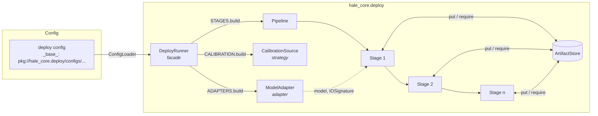
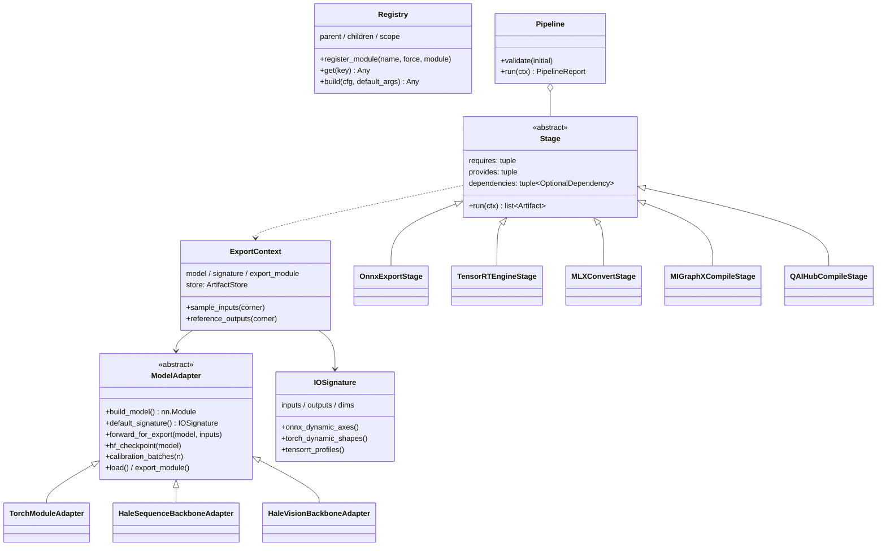
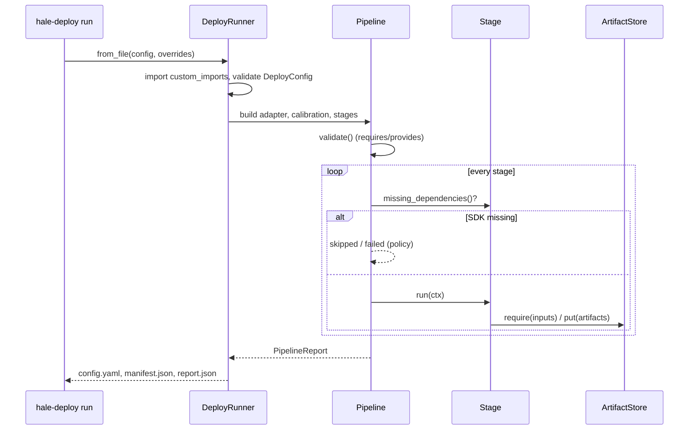
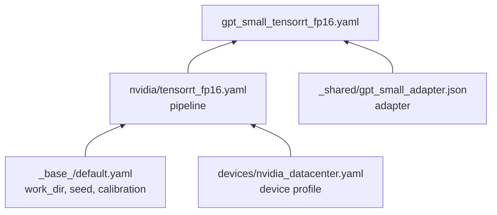
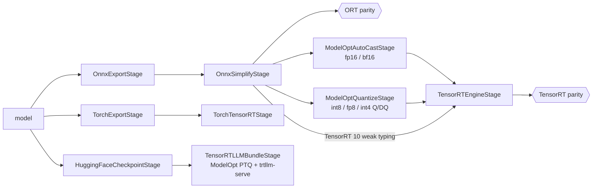
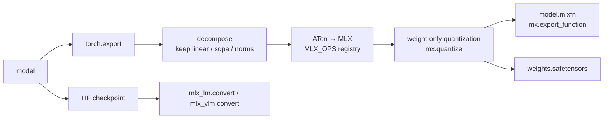
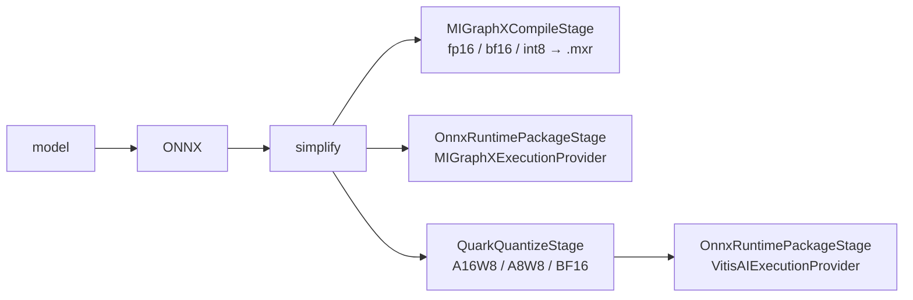
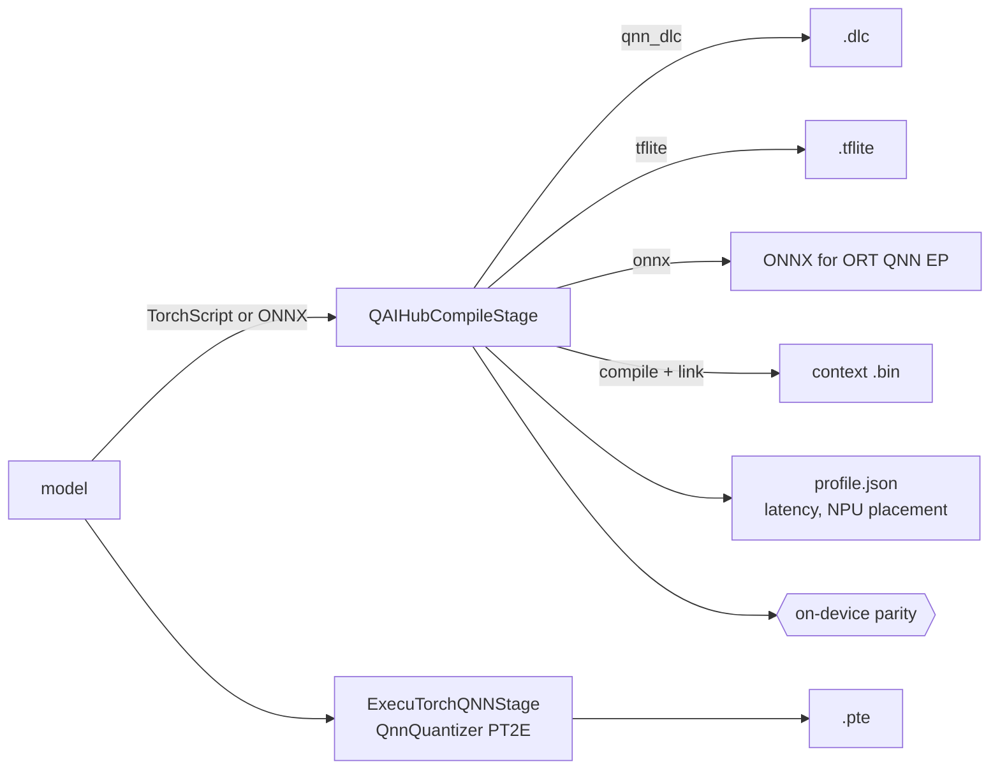

# Deployment: NVIDIA, Apple, AMD and Qualcomm targets

`hale_core.deploy` turns any Hale model (and any `nn.Module`) into deployable artifacts for

| vendor | hardware | artifact | runtime |
|---|---|---|---|
| **NVIDIA** | H100 / H200 / B200 / L40S, RTX 40/50, Jetson Orin / Thor | `.engine`, Torch-TensorRT `.ep`, TensorRT-LLM bundle | TensorRT 10/11, TensorRT for RTX, `trtllm-serve` |
| **Apple** | M1–M5 MacBook / Mac Studio | `.mlxfn` + `weights.safetensors`, mlx-lm / mlx-vlm dirs | MLX (Python, C++, Swift) |
| **AMD** | Instinct MI300/MI355, Radeon RX 7900/9070, Ryzen AI NPU | `.mxr`, Quark-quantized ONNX | MIGraphX, ONNX Runtime (MIGraphX / Vitis AI EPs) |
| **Qualcomm** | Snapdragon 8 Elite / 8 Gen 3 phones, X Elite PCs, QCS robotics SoCs | `.dlc`, `.tflite`, context `.bin`, ExecuTorch `.pte` | QNN / QAIRT, LiteRT, ONNX Runtime QNN EP, ExecuTorch |

One YAML file describes a deployment: **which model** (adapter), **which device** (profile),
**which steps** (pipeline). Every step is a registered class, and every exported artifact is
checked numerically against PyTorch wherever its runtime is available.

- [Quick start](#quick-start)
- [Architecture](#architecture)
- [Configs and inheritance](#configs-and-inheritance)
- [Targets](#targets)
- [The PyTorch → MLX bridge](#the-pytorch--mlx-bridge)
- [Validation](#validation)
- [Extending](#extending)
- [Third-party sources (`ext_pkgs/`)](#third-party-sources-ext_pkgs)
- [Research notes (October 2026)](#research-notes-october-2026)

## Quick start

```bash
uv pip install -e ".[deploy]"            # + [deploy-apple] / [deploy-nvidia] / [deploy-amd] / [deploy-qualcomm]
hale-deploy env                          # which backends this machine can run
hale-deploy list                         # registered stages, adapters, runtimes, calibration sources
hale-deploy show configs/deploy/gpt_small_tensorrt_fp16.yaml          # merged config after _base_
hale-deploy run  configs/deploy/gpt_tiny_onnx_ort.yaml                # runs anywhere
hale-deploy run  configs/deploy/gpt_tiny_mlx_fp32.yaml                # Apple Silicon
hale-deploy run  configs/deploy/gpt_small_tensorrt_fp16.yaml \
    --cfg-options pipeline.4.precision=bf16 work_dir=/data/engines      # NVIDIA GPU
```

Python:

```python
from hale_core.deploy import DeployRunner

report = DeployRunner.from_file("configs/deploy/resnet50_tensorrt_int8.yaml").run()
assert report.ok
```

Each run writes `work_dir/<name>/` with one directory per stage plus `config.yaml` (the fully
merged config), `manifest.json` (every artifact with size, sha256 and lineage) and
`report.json` (status and timing per stage).

## Architecture





Design choices:

* **Registries (mmdet style)** - `STAGES`, `ADAPTERS`, `RUNTIMES`, `CALIBRATION`, `MLX_OPS`.
  Downstream repos add a child registry (`Registry("adapter", parent=ADAPTERS, scope="hale_llm")`)
  and load it with `custom_imports`; `hale_llm.SomeAdapter` resolves a scoped name.
* **Adapters** keep model code out of the framework: a repo says how to build its model, what
  the inputs are, and how to call it. Everything else is generic.
* **One signature, many dialects** - `IOSignature` (named inputs, dtypes, `min/opt/max` per
  dynamic dim) is converted to ONNX dynamic axes, `torch.export.Dim`s, TensorRT optimization
  profiles, MIGraphX input dims and AI Hub input specs. Tracing uses a dedicated `trace` size
  (≥ 2), because `torch.export` silently turns any size-1 dimension into a constant.
* **Fail fast** - `Pipeline.validate()` checks the data flow (`requires`/`provides`) in one pass
  before any work; missing SDKs are detected without importing them.
* **Lazy vendor imports** - every SDK is imported inside `run()`, so one config can be validated
  on a laptop and executed on the build machine (`skip_if_unavailable`, `on_error: continue`).



## Configs and inheritance

Configs are YAML or JSON. `_base_` (a path or list of paths) is merged first, then the file:

```yaml
# configs/deploy/gpt_small_tensorrt_fp16.yaml
_base_:
  - pkg://hale_core.deploy/configs/nvidia/tensorrt_fp16.yaml   # packaged target
  - ./_shared/gpt_small_adapter.json                           # this repo's model
pipeline:                                                      # optional: replace the stage list
  - ...
adapter:
  checkpoint: /ckpt/gpt_small.safetensors                      # merged into the inherited adapter
```



Rules: mappings merge recursively; lists and scalars are replaced; `_delete_: true` inside a
mapping replaces the inherited mapping instead of merging; cycles are reported with the full
chain; `pkg://package/path` resolves inside an installed package so every repo can inherit the
packaged targets. CLI overrides use dotted paths with list indices: `--cfg-options
pipeline.3.precision=int8 adapter.max_batch=16`.

Packaged configs (`src/hale_core/deploy/configs/`):

| directory | configs |
|---|---|
| `_base_/` | `default`, `onnx_reference` |
| `devices/` | `nvidia_datacenter`, `nvidia_rtx`, `nvidia_jetson_orin`, `nvidia_jetson_thor`, `apple_silicon`, `amd_instinct`, `amd_radeon`, `amd_ryzen_ai_npu`, `qualcomm_snapdragon_8_elite`, `qualcomm_snapdragon_8_gen3`, `qualcomm_snapdragon_x_elite` |
| `nvidia/` | `tensorrt_fp16`, `tensorrt_int8_modelopt`, `tensorrt_fp8`, `tensorrt_rtx_fp16`, `jetson_orin_dla_fp16`, `jetson_orin_gpu_int8`, `torch_tensorrt_fp16`, `tensorrt_llm_fp8`, `tensorrt_llm_int4_edge` |
| `apple/` | `mlx_fp32`, `mlx_fp16`, `mlx_int4`, `mlx_lm_q4`, `mlx_vlm_q4` |
| `amd/` | `migraphx_fp16`, `migraphx_int8`, `onnxruntime_migraphx_ep`, `ryzen_ai_npu_a16w8`, `ryzen_ai_npu_bf16` |
| `qualcomm/` | `aihub_qnn_dlc_w8a16`, `aihub_tflite_int8`, `aihub_context_binary`, `aihub_onnx_x_elite`, `executorch_qnn_16a8w` |

## Targets

### NVIDIA



* **TensorRT 11** builds *strongly typed* engines only: the precision is in the ONNX graph.
  `ModelOptAutoCastStage` (FP16/BF16) or `ModelOptQuantizeStage` (INT8/FP8/INT4 Q/DQ) runs
  first. On **TensorRT 10** the same configs work, and without ModelOpt the stage falls back to
  the legacy `FP16`/`INT8` builder flags. Both versions are feature-detected.
* **Jetson Orin** (`jetson_orin_dla_fp16`): build on the device; `dla_core: 0` with GPU fallback
  puts convolution-heavy vision towers on the DLA. **Jetson Thor** / LLMs: use
  TensorRT-Edge-LLM (vendored in `ext_pkgs/`) or the TensorRT-LLM bundle.
* **RTX** (`tensorrt_rtx_fp16`): `runtime_module: tensorrt_rtx` - same builder API, small
  runtime, engines JIT-specialised on the user's GPU.
* **LLMs**: TensorRT-LLM ≥ 1.2 has only the PyTorch backend (no `trtllm-build`), so the
  deployable unit is an HF checkpoint (optionally ModelOpt-quantized: `fp8` for
  Hopper/Ada, `nvfp4` for Blackwell, `int4_awq` for edge) plus `extra_llm_api_options.yaml` and
  a `serve.sh` that starts `trtllm-serve`.

### Apple Silicon



* `MLXConvertStage` works for **any** traceable model (no MLX re-implementation needed); see
  [the bridge](#the-pytorch--mlx-bridge). The `.mlxfn` runs from Python, C++ or Swift.
* `MLXHuggingFaceConvertStage` uses the upstream mlx-lm / mlx-vlm converters for HF text and
  vision-language models (native KV cache, `mlx_lm.server`).

### AMD



* **Instinct / Radeon**: ROCm 7.1+ removed ONNX Runtime's ROCm EP; MIGraphX (ahead-of-time
  `.mxr`, or ORT's MIGraphX EP) is the supported path. The stage uses MIGraphX's Python API and
  falls back to `migraphx-driver`.
* **Ryzen AI NPU**: quantize with AMD Quark (`A16W8` for transformers, `A8W8`/`XINT8` for CNNs,
  `BF16` without calibration) and run with ONNX Runtime's Vitis AI EP. Both Quark config APIs
  (0.10+ `QConfig`, older `Config`) are supported.

### Qualcomm



* **AI Hub** compiles in the cloud for a real device and returns the asset, a profile and
  (optionally) on-device outputs for parity. `int64` I/O is truncated to `int32` for the NPU
  runtimes automatically. Context binaries come from compile-and-link jobs
  (`qnn_context_binary` / `precompiled_qnn_onnx` compile targets were deprecated in 2026).
* **ExecuTorch QNN** lowers locally with the QAIRT SDK (`QNN_SDK_ROOT`), with optional PT2E
  quantization (`8a8w`, `16a8w`, `16a16w`, `16a4w`). It traces at the `opt` shape because the
  HTP compiles static shapes.

### Which config for which device

| device | vision / CNN / small transformer | LLM / text tower |
|---|---|---|
| H100 / H200 / L40S | `nvidia/tensorrt_fp16`, `tensorrt_fp8` | `nvidia/tensorrt_llm_fp8` |
| B200 / GB200 | `nvidia/tensorrt_fp16` | `tensorrt_llm_fp8` with `quantization: nvfp4` |
| RTX 40/50 laptop or desktop | `nvidia/tensorrt_rtx_fp16` | `tensorrt_llm_int4_edge` |
| Jetson Orin | `jetson_orin_dla_fp16`, `jetson_orin_gpu_int8` | `tensorrt_llm_int4_edge`, TensorRT-Edge-LLM |
| MacBook (M-series) | `apple/mlx_fp16`, `mlx_int4` | `apple/mlx_lm_q4`, `mlx_vlm_q4` |
| MI300X / MI355X | `amd/migraphx_fp16`, `onnxruntime_migraphx_ep` | HF checkpoint + vLLM-ROCm (not packaged) |
| Ryzen AI laptop | `amd/ryzen_ai_npu_a16w8`, `ryzen_ai_npu_bf16` | Ryzen AI LLM flow (OGA), not packaged |
| Snapdragon phone | `qualcomm/aihub_qnn_dlc_w8a16`, `aihub_tflite_int8`, `executorch_qnn_16a8w` | `aihub_context_binary` + Genie |
| Snapdragon X Elite PC | `qualcomm/aihub_onnx_x_elite` | ORT GenAI with QNN EP |

## The PyTorch → MLX bridge

`AtenToMLXConverter` exports the module with `torch.export`, decomposes it to core ATen while
**keeping** `linear`, `scaled_dot_product_attention`, `layer_norm`, `rms_norm`, `gelu`, `silu`,
`softmax`, `conv2d`, `adaptive_avg_pool2d` (they map to MLX fused kernels), then looks up every
FX node in the `MLX_OPS` registry (~120 ATen overloads). Unsupported ops are collected and
reported **all at once**.

`MLXProgram` interprets the node list. A reverse liveness pass marks the last use of every
value, and the interpreter frees it right after, so the live set stays at a few activations.
Weight-only quantization rewrites `linear` nodes with parameter weights into
`mx.quantized_matmul` (per-group scales/biases), and drops the dense copies.

Verified here (Apple M-series, MLX 0.32.4, torch 2.13), fp32 max-abs error vs PyTorch:

| model | max abs error |
|---|---|
| tiny GPT (causal SDPA, dynamic batch × seq, min/opt/max) | 1.9e-5 |
| ResNet-18 / ResNet-50 / SE-ResNet-50 | 1.8e-7 / 1.5e-7 / 1.2e-7 |
| ConvNeXt-T, EfficientNet-B0, MobileNet-v1, RegNetY-002, MobileOne-S0 | ≤ 4.9e-6 |
| ViT-S, DeiT3-S, DINO ViT-S | ≤ 6.5e-6 |
| int4 / int8 weights (tiny GPT) | cosine 0.9965 / 0.999+, argmax agreement 100% |

Adding an op:

```python
from hale_core.deploy.registry import MLX_OPS
import mlx.core as mx

@MLX_OPS.register_module(name=["aten.erfc.default"])
def erfc(x):
    return 1 - mx.erf(x)
```

## Validation

`RuntimeParityStage` runs any artifact through a registered `InferenceSession`
(`OnnxRuntimeSession`, `TensorRTSession`, `MLXFunctionSession`, `MIGraphXSession`) at the
signature corners you list (`min`, `opt`, `max`) and compares with the PyTorch reference:
an output passes when `max_abs <= atol` **or** `cosine >= min_cosine`; an optional
`min_argmax_agreement` guards logits. Results go to `<stage>/parity.json`. AI Hub can do the
same on a physical phone (`validate_on_device: true`).

## Extending

**A new model** - subclass `ModelAdapter` in your repo:

```python
from hale_core.deploy.adapters import ModelAdapter
from hale_core.deploy.core.io_signature import IOSignature
from hale_core.deploy.registry import ADAPTERS, Registry

MY_ADAPTERS = Registry("adapter", parent=ADAPTERS, scope="my_pkg")

@MY_ADAPTERS.register_module()
class PolicyAdapter(ModelAdapter):
    def build_model(self):
        return build_my_policy(self.cfg)

    def default_signature(self):
        return IOSignature.from_config({
            "inputs": [{"name": "image", "shape": ["batch", 3, 224, 224]}],
            "outputs": ["actions"],
            "dims": {"batch": [1, 1, 4]},
        })

    def forward_for_export(self, model, inputs):
        return {"actions": model.act(inputs["image"])}
```

and reference it with `custom_imports: [my_pkg.deploy]`, `adapter: {type: my_pkg.PolicyAdapter}`.

**A new backend** - subclass `Stage`, declare `requires` / `provides` / `dependencies`, import
the SDK inside `run`, register with `@STAGES.register_module()`, and (for parity) add an
`InferenceSession` to `RUNTIMES`.

## Third-party sources (`ext_pkgs/`)

Vendor SDK sources are shallow git submodules for reading examples, samples and op-support
tables offline. They are **not** imported: runtime dependencies come from the pip extras.
See [`ext_pkgs/README.md`](../ext_pkgs/README.md). Fetch them with
`git submodule update --init --depth 1` (never `--recursive`; ExecuTorch alone has dozens of
nested submodules).

## Research notes (October 2026)

* **TensorRT 11** removes the precision builder flags (`kFP16`, `kINT8`, `kBF16`, `kFP8`) and the
  INT8 calibrators; networks are strongly typed and ModelOpt AutoCast / Q/DQ quantization
  provides the precision. TensorRT 10.x still supports both modes.
  [migration guide](https://docs.nvidia.com/deeplearning/tensorrt/latest/api/migration/tensorrt-10x-to-11x-c-api-patterns.html),
  [releases](https://github.com/NVIDIA/TensorRT/releases),
  [ModelOpt changelog](https://nvidia.github.io/Model-Optimizer/reference/0_changelog.html)
* **TensorRT-LLM 1.2** removed the TensorRT engine backend and `trtllm-build`; the PyTorch
  backend (`tensorrt_llm.LLM`, `trtllm-serve`) loads HF checkpoints.
  [release notes](https://nvidia.github.io/TensorRT-LLM/release-notes.html),
  [PyTorch backend](https://nvidia.github.io/TensorRT-LLM/torch.html)
* **MLX 0.32 / mlx-lm 0.32**: `mx.export_function` / `mx.exporter` write portable `.mlxfn`
  graphs; `mlx_lm.convert` quantizes HF checkpoints (`q_bits`, `q_group_size`).
  [mlx-lm on PyPI](https://pypi.org/project/mlx-lm/),
  [WWDC25 MLX session](https://developer.apple.com/videos/play/wwdc2025/298/)
* **AMD**: ONNX Runtime's ROCm EP ends with ROCm 7.0; MIGraphX (and its ORT EP) replaces it.
  Ryzen AI NPUs run INT8/BF16 ONNX through the Vitis AI EP; quantize with Quark (A16W8
  recommended for transformers).
  [ROCm EP notice](https://onnxruntime.ai/docs/execution-providers/ROCm-ExecutionProvider.html),
  [MIGraphX Python API](https://rocm.docs.amd.com/projects/AMDMIGraphX/en/docs-7.2.3/reference/MIGraphX-py.html),
  [Vitis AI EP](https://onnxruntime.ai/docs/execution-providers/Vitis-AI-ExecutionProvider.html),
  [Quark ONNX config](https://quark.docs.amd.com/v0.11.1/onnx/user_guide_config_description.html),
  [Ryzen AI 1.7](https://ryzenai.docs.amd.com/_/downloads/en/1.7/pdf/)
* **Qualcomm AI Hub**: runtimes `tflite`, `qnn_dlc`, `onnx`; `qnn_context_binary` (Mar 2026) and
  `precompiled_qnn_onnx` (May 2026) were deprecated as compile targets in favour of
  `submit_compile_and_link_jobs`; `--truncate_64bit_io` is required for int64 I/O on
  TFLite/QNN. [API](https://workbench.aihub.qualcomm.com/docs/hub/api.html),
  [release notes](https://workbench.aihub.qualcomm.com/docs/hub/release_notes.html)
* **ExecuTorch QNN**: `generate_htp_compiler_spec` + `generate_qnn_executorch_compiler_spec` +
  `to_edge_transform_and_lower_to_qnn`; PT2E quantization with `QnnQuantizer`; QNN SDK 2.37
  recommended. [Qualcomm backend docs](https://docs.pytorch.org/executorch/1.2/_sources/backends-qualcomm.md.txt)
