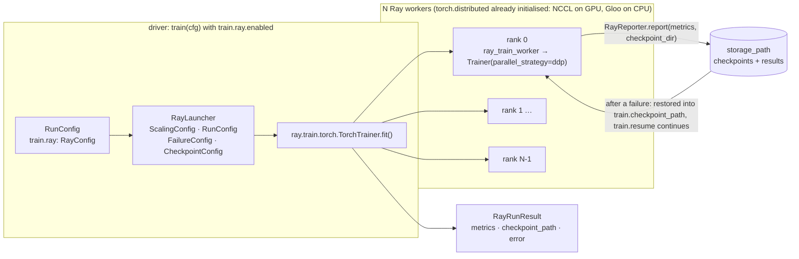
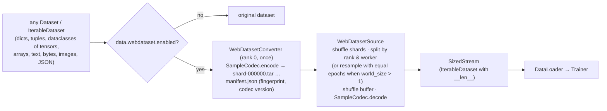

# Ray Train backend and WebDataset

Two optional, config-driven features shared by every Hale* repo. Both are **off by default**;
nothing changes for existing configs.

| feature | flag | install | package |
|---|---|---|---|
| Ray Train launcher (multi-GPU / multi-node, fault tolerant) | `train.ray.enabled: true` | `hale-blocks[ray]` | `hale_core.distributed.ray` |
| Any dataset → WebDataset tar shards → streamed back | `data.webdataset.enabled: true` | `hale-blocks[webdataset]` | `hale_core.data.webdataset` |

`pip install "hale-blocks[distributed]"` installs both.

## Ray Train



**How it works.** Ray starts `num_workers` processes and initialises the `torch.distributed`
process group between them (it sets `RANK`, `LOCAL_RANK` and `WORLD_SIZE`). Inside each worker,
`hale_core.training.train()` runs the normal trainer with `parallel_strategy=ddp`, or `fsdp` if
configured. `setup_distributed()` sees the existing process group, so the DDP code path is
unchanged.

| piece | role |
|---|---|
| `RayConfig` (`config/sections/ray.py`) | cluster address, workers, GPUs/resources, placement, backend, storage, failures |
| `RayLauncher` | driver: `RayConfig` → `TorchTrainer` → `RayRunResult`; starts a local Ray instance or joins `address` |
| `WorkerContext` | rank / local rank / world size of this process (Ray, torchrun, env vars or single process) |
| `RayReporter` | worker: report metrics + checkpoint directory (no-op outside Ray) |
| `training/ray_entry.py` | ships the config to the workers and restores Ray's checkpoint after a failure |

```yaml
train:
  parallel_strategy: ddp          # or fsdp; "none" is upgraded to ddp inside Ray workers
  ray:
    enabled: true
    address: auto                 # omit for a local Ray instance
    num_workers: 8
    use_gpu: true
    resources_per_worker: {CPU: 8, GPU: 1}
    storage_path: /shared/ray_results   # local path, NFS or s3://
    max_failures: 3               # restart the worker group up to 3 times
    num_to_keep: 2
```

```python
from hale_core.training import train

result = train(cfg, tokenizer, data_module_factory=make_data, evaluator_factory=Evaluator)
print(result.metrics, result.checkpoint_path)    # RayRunResult (the model lives in the workers)
```

* Keyword arguments are cloudpickled to the workers. Pass `<name>_factory=callable` for objects
  that should be built inside each worker; it is called there and passed as `<name>`.
* Every rank reports at the end of each epoch, and rank 0 attaches the checkpoint directory. Ray
  Train V2 only keeps metrics that come with a checkpoint, so keep `train.checkpoint_every_epoch:
  true` to see metrics in `RayRunResult`.
* Map-style datasets built by the default loader get a `DistributedSampler` under DDP and Ray, and
  the trainer calls `set_epoch` each epoch, so every rank reads a disjoint shard of the data.
* Any training function can use the launcher directly:
  `RayLauncher(cfg).launch(train_fn, loop_config)`.

## WebDataset



```python
from hale_core.data.webdataset import WebDatasetAdapter

adapter = WebDatasetAdapter(cfg.data.webdataset)
train_set = adapter.prepare(train_set, "train", loader_workers=cfg.data.loader.num_workers)
val_set = adapter.prepare(val_set, "val", training=False)

# Plain iterables (streaming mixtures): the factory only runs when shards must be written.
stream = adapter.prepare_iterable(lambda: build_vlm_dataloader(names, samples_per_dataset=500),
                                  "vlm-mix", fingerprint=fingerprint(names=names, n=500))
```

HaleBlocks' own `MixedVLMDataModule` / `MixedLLMDataModule` take `webdataset=cfg.data.webdataset`:
with the flag on, the Hugging Face streams are converted once (they must be finite, so set
`samples_per_dataset` or `max_samples`) and later runs never open them.

```yaml
data:
  webdataset:
    enabled: true
    root: /fast_disk/shards       # <root>/<name>/shard-*.tar + manifest.json
    samples_per_shard: 2000
    convert_workers: 8            # parallel reads of the source while converting
    shuffle_buffer: 5000
    resample: auto                # equal epochs on every rank when training on several ranks
```

* **Lossless.** `SampleCodec` stores each leaf in a self-describing format (`.pth` for tensors,
  `.npy`, `.txt`, `.bin`, `.json`, `.png`) plus a `hale.meta.json` structure entry. Decoding
  rebuilds the same object: same nesting, dtypes and values, tuples stay tuples, dataclasses
  are re-instantiated, and `Enum` members (including `StrEnum` / `IntEnum`) and `pathlib` paths
  come back with their own types. A path is stored as a path, not the file it points to.
  Codec v2 added enums and paths; v1 shards still decode, and stale manifests are re-converted.
* **Converted once.** Shards are reused while the manifest's fingerprint matches. The default
  fingerprint is class + length + limits; pass `fingerprint=` (for example a hash of the data
  config) when the content can change while the class and length stay the same.
  `overwrite: true` forces a rewrite.
* **Crash-safe.** Shards are written to a temporary directory and renamed into place.
* **Distributed.** Rank 0 converts while the other ranks wait at a barrier. With several ranks,
  training streams use resampled shards and a fixed epoch of `num_samples / world_size`, so every
  rank runs the same number of steps (required by DDP). Evaluation streams split the shards so each
  sample is read once.
* `len(stream)` is the per-rank epoch length, so `len(DataLoader)` and LR schedules keep working.
